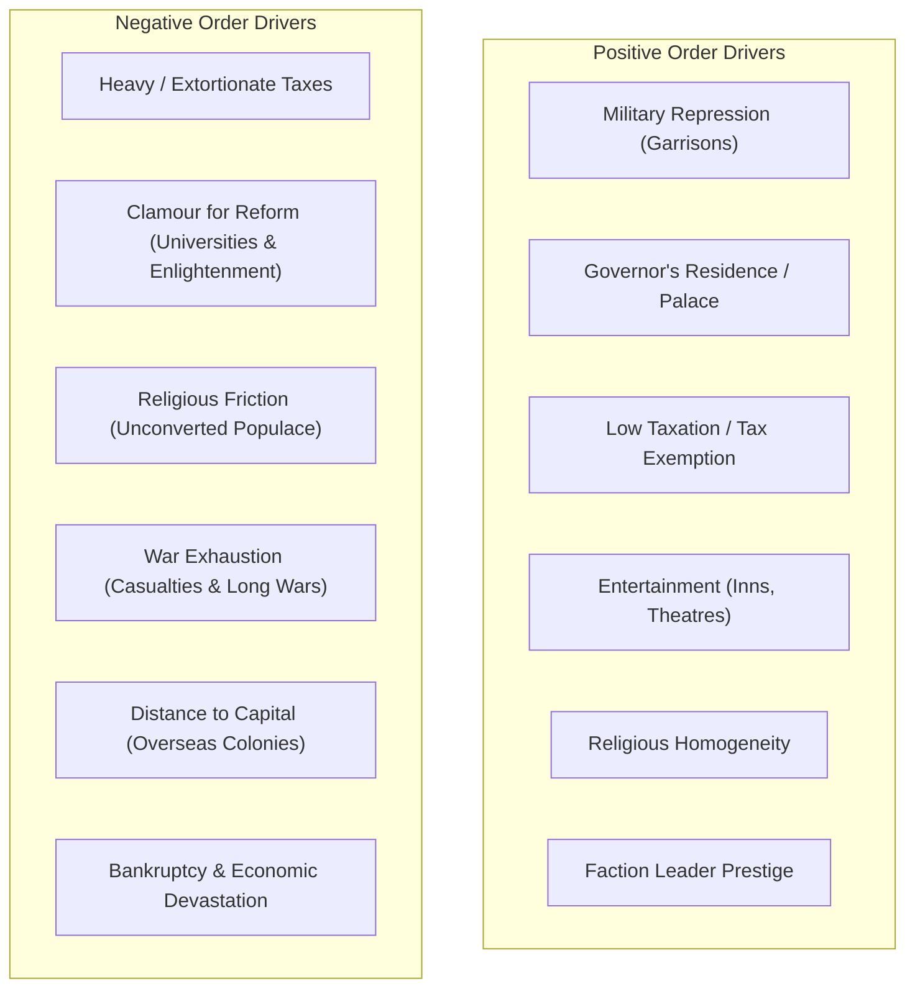
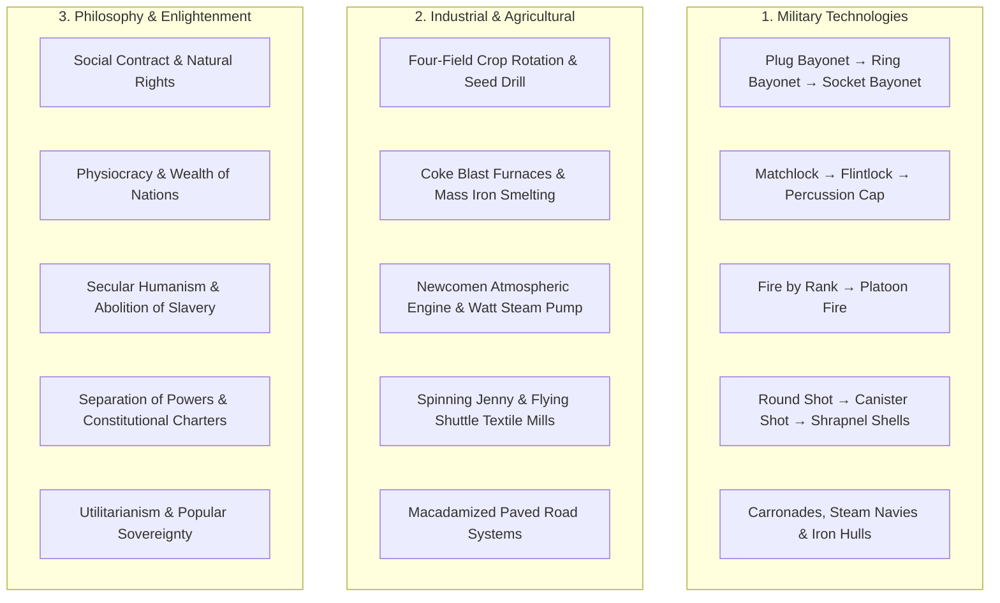

# *Empire: Total War* — Comprehensive Grand Campaign Specification & Reference

An exhaustive, authoritative reference of every mechanic, system, and formula governing the turn-based **Grand Campaign** layer of *Empire: Total War* (excluding real-time 3D tactical battles).

---

## Table of Contents
1. [Strategic Map, Theaters & Territorial Architecture](#1-strategic-map-theaters--territorial-architecture)
2. [Demographics, Settlement Evolution & Infrastructure](#2-demographics-settlement-evolution--infrastructure)
3. [Economy, Taxation & Financial Physics](#3-economy-taxation--financial-physics)
4. [Trade Networks, Commodities & Maritime Commerce](#4-trade-networks-commodities--maritime-commerce)
5. [Government, Cabinet Politics & Revolutions](#5-government-cabinet-politics--revolutions)
6. [Public Order, Social Strata & Dissent](#6-public-order-social-strata--dissent)
7. [Military Operations, Armies & Campaign Stances](#7-military-operations-armies--campaign-stances)
8. [Strategic Naval Warfare & Maritime Logistics](#8-strategic-naval-warfare--maritime-logistics)
9. [Technology, Research & The Enlightenment](#9-technology-research--the-enlightenment)
10. [Strategic Agents & Covert Actions](#10-strategic-agents--covert-actions)
11. [Diplomacy, Treaties & Geopolitics](#11-diplomacy-treaties--geopolitics)
12. [Emergent Nations, Rebellions & Pirates](#12-emergent-nations-rebellions--pirates)
13. [Cabinet Missions, Prestige & Victory Conditions](#13-cabinet-missions-prestige--victory-conditions)

---

## 1. Strategic Map, Theaters & Territorial Architecture

### 1.1 The Multi-Theater Global Architecture
* **Three Primary Land Theaters**:
  1. **Europe, North Africa & the Near East**: Dense urban clusters, advanced educational institutions, complex diplomatic webs.
  2. **The Americas & Caribbean**: Expansive colonial wilderness, cash-crop plantations, Native American tribal territories.
  3. **The Indian Subcontinent**: High-density population centers, immense regional wealth, religious friction between Mughal imperial forces and Maratha confederates.
* **Four Maritime Trade Theaters (Off-Map Economic Zones)**:
  1. **Ivory Coast** (Slaves/Ivory)
  2. **Straits of Malacca** (Spices)
  3. **East Indies** (Spices & Silk)
  4. **Madagascar** (Spices & Exotic Goods)
* **Inter-Theater Transit**:
  * Fleets cross designated oceanic transit zones along map perimeters.
  * Transit takes a defined duration (typically 2 to 3 seasonal turns). Armies embarked on ships transit seamlessly with their fleet.

### 1.2 Provincial Topography & Borders
* **Province Hierarchy**:
  * **Major Capital Provinces**: Feature walled star-fortresses, extensive building slots (up to 6 inside capital), and provincial government palaces (e.g., London, Paris, Delhi, Madrid).
  * **Minor Capital Provinces**: Feature unwalled or lightly palisaded towns with 2–3 building slots.
* **Topographical Chokepoints**:
  * Rivers crossed only via bridges or designated shallow fords.
  * Mountain passes (Alps, Pyrenees, Khyber Pass) restricting army movement to narrow corridors.
* **Fog of War & Vision Radii**:
  * Black unexplored map vs. Grey shaded fog of war.
  * Vision lines cast dynamically by:
    * Armies and generals (radius scales with general command and light cavalry scout units).
    * Navies (radius scales with ship masts/crow's nest tech).
    * Settlement watchtowers and fortresses.
    * Active strategic agents (Rakes, Gentlemen, Missionaries).

---

## 2. Demographics, Settlement Evolution & Infrastructure

### 2.1 The Decentralized "Open Map" Model
Unlike Rome or Medieval II, *Empire* distributes provincial infrastructure across the rural landscape:
* **The Provincial Capital**: Administrative core (Government Palace, Core Barracks, Artillery Foundry, Ordnance Factory).
* **Emergent Villages & Towns**: Villages that do not exist at campaign start, but spawn dynamically as the province's population grows over time. Upon spawning, the player permanently chooses their specialization:
  * **Educational**: *School &rarr; College &rarr; University* (generates Research points; spawns Gentlemen).
  * **Religious**: *Church School &rarr; Church Mission &rarr; Seminary* (converts population to state religion; spawns Missionaries/Imams/Priests).
  * **Industrial / Manufacturing**: *Weavers, Iron Foundries, Potteries* (boosts regional town wealth and export goods).
  * **Social / Entertainment**: *Coaching Inn &rarr; Pleasure Gardens* (enhances local public order; spawns Rakes/Spies).
* **Fixed Rural Resource Nodes**:
  * **Farms & Plantations**: Wheat fields, rice paddies, sheep pastures, sugar cane, tobacco, tea, coffee, cotton plantations.
  * **Mines**: Iron, coal, gold, silver, diamond mines.
  * **Forestry**: Logging camps providing timber for naval drydocks.
* **Ports**: Coastal settlements built as **Commercial Trade Ports**, **Naval Shipyards**, or **Fishing Harbors**.
* **Road Networks**: Upgraded across the entire province (*Dirt Track &rarr; Cobblestone Highway &rarr; Paved Macadamized Highway*), directly multiplying army campaign movement range and facilitating domestic trade volume.

### 2.2 Population Dynamics & Growth Formula
* Population growth rate is calculated dynamically each turn:
  $$\text{Net Growth Rate} = \text{Agricultural Surplus} + \text{Public Health Buffs} - \text{Tax Burden} - \text{War Devastation}$$
* High agricultural surplus drives migration and population booms.
* Crossing population milestones (e.g., 100k, 250k, 500k, 1M, 2M) triggers the construction of a new emergent town slot in that province.

---

## 3. Economy, Taxation & Financial Physics

### 3.1 Dual-Layer Regional Wealth
Every province possesses two distinct wealth metrics:
1. **Subsistence Wealth**: Baseline food and survival production of agrarian peasants.
2. **Town Wealth**: Commercial and industrial wealth accumulated in factories, mines, and ports.
   * **Dynamic Town Wealth Growth**: Grows each turn based on low tax incentives, infrastructure quality, trade connections, and governor traits:
     $$\text{Wealth}_{\text{next}} = \text{Wealth}_{\text{current}} + \Delta \text{Growth}$$
   * Prolonged heavy taxation reduces growth to negative numbers, causing economic stagnation and atrophy.

### 3.2 The Class-Segregated Taxation Engine
* **Theater-Wide Sliders**: Taxes are managed globally per theater (Europe, Americas, India) across two distinct social classes:
  * **Upper Class (Nobility / Aristocracy)**: Controls land and political power. Taxing them harms public order among elites and depresses recruitment.
  * **Lower Class (Commoners / Laborers)**: Comprises peasants, factory hands, and smallholders. Taxing them harms working-class order and stunts town growth.
* **Five Tax Tiers**: *Exempt, Low, Normal, High, Extortionate*.
* **Province-Specific Tax Exemption**:
  * Individual provinces can be toggled to "Tax Exempt".
  * Exempted provinces contribute 0g in tax, but receive massive public order boosts (+8 to +12) and accelerated population growth. Used to calm newly captured hostile territories or pacify impending revolts.

### 3.3 National Expenditures & Bankruptcy
* **National Treasury Expenses**:
  * Unit Upkeep (armies and navies draw turn-by-turn maintenance fees).
  * Colonial Maintenance (administering distant overseas colonies).
  * Building Construction & Repair Costs.
  * Diplomatic Gifts, Tribute & Protectorate Subsidies.
  * Espionage & Agent Recruitment Fees.
* **Bankruptcy Mechanics**:
  * If the national treasury hits zero and cannot pay upkeep:
    * Armies suffer massive **desertion** (units lose soldiers or disband entirely).
    * Public order across all provinces plummets due to civil non-payment.
    * Recruitment and construction immediately halt.

---

## 4. Trade Networks, Commodities & Maritime Commerce

### 4.1 Global Commodities & Real-Time Market Pricing
* Eight trade commodities exist in the global economy:
  1. **Sugar**
  2. **Tobacco**
  3. **Cotton**
  4. **Spices**
  5. **Coffee**
  6. **Tea**
  7. **Silk**
  8. **Furs**
* **Dynamic Supply-and-Demand Market**:
  * Global commodity prices fluctuate dynamically based on total world production vs. total global consumption.
  * Flooding the market with American sugar or Indian spices drops their per-ton price; burning rival plantations causes commodity prices to spike.

### 4.2 Trade Routes & Maritime Logistics
* **Domestic Overland Routes**: Physical road connections between neighboring friendly provinces.
* **Maritime Trade Lanes**: Visible dashed sea lanes linking ports of production directly to the importing capital's port.
* **Trade Capacity Constraints**: A commercial port can only handle a limited number of active trade lanes (1 lane for a basic port, up to 3–4 for an advanced Commercial Basin).

### 4.3 Trade Theaters & Indiamen Fleets
* In the 4 Maritime Trade Theaters (Ivory Coast, Malacca, East Indies, Madagascar), static gold circular **Trade Anchor Nodes** exist.
* Stationing dedicated **Merchant Indiamen** ships on these nodes harvests massive shipments of commodities and gold every turn.
* Multiple Indiamen stacked in a trade node yield diminishing returns per ship.

### 4.4 Commerce Raiding, Piracy & Port Blockades
* **Trade Route Raiding**: An enemy or pirate fleet sitting directly on an active trade line intercepts and steals a percentage of the route's value each turn.
* **Port Blockades**: Moving a hostile warship into an enemy port entrance blockades it:
  * All sea trade routes terminating or originating at that port are frozen.
  * No ships can be constructed or repaired in the blockaded port.
  * Regional export income drops to 0.

---

## 5. Government, Cabinet Politics & Revolutions

### 5.1 Three Forms of Government

| Mechanic | Absolute Monarchy | Constitutional Monarchy | Republic |
| :--- | :--- | :--- | :--- |
| **Head of State** | King / Queen / Emperor (Lifelong reign) | King / Queen (Lifelong reign) | President (Term limits; 4–8 turns) |
| **Cabinet Freedom** | Complete (Appoint, dismiss, shuffle at will) | Moderate (Can replace 1 minister per turn) | Limited (Replaced upon election defeats) |
| **Upper Class Happiness** | High (+nobility privilege) | Moderate | None (Nobility replaced by Burghers) |
| **Lower Class Happiness** | Low (-repression friction) | Balanced | Very High (+democratic representation) |
| **Research Rate** | Slower (Intellectual censorship) | Balanced | Fastest (+scientific freedom) |
| **Clamour for Reform** | Severe public order penalty | Mild penalty | Zero penalty (Absorbed by constitution) |
| **Diplomatic Affinity** | Loved by Monarchies; Hated by Republics | Balanced | Loved by Republics; Feared by Monarchies |

### 5.2 The Cabinet (Council of Ministers)
Ministers possess 1 to 9 command stars, personality traits, personal loyalty, and corruption levels:
1. **Head of State**: Faction leader providing global prestige, army morale, and diplomatic authority.
2. **Head of Government (Prime Minister / Grand Vizier / Peshwa)**: Regulates administrative efficiency; poor stats increase global corruption.
3. **Minister of Justice / Interior**: Controls provincial repression and mitigates working-class dissent.
4. **Minister of the Treasury**: Governs tax collection efficiency, tariff yields, and national borrowing rates.
5. **Minister of War**: Decreases land army upkeep and unit recruitment costs.
6. **Minister of the Admiralty**: Decreases warship upkeep and naval shipyard construction costs.
* **Opposition Benches**: Under Constitutional Monarchies and Republics, an opposition shadow cabinet waits. When the ruling party loses an election, the shadow ministers replace the current cabinet.

### 5.3 Dynastic Lineage & Wars of Succession
* Monarchies track royal lineage. When a sovereign dies without a direct, legitimate heir:
  * A rival foreign power with historical marriages or dynastic ties can contest the crown.
  * A **War of Succession** triggers: the challenger declares war, claiming the throne and forcing allies to take sides.

---

## 6. Public Order, Social Strata & Dissent

### 6.1 Drivers of Public Order
Measured separately for the Upper Class and Lower Class in every region (scale: -30 to +30):

### 6.2 Escalation of Dissent & Strikes
When public order falls below zero in consecutive turns:
1. **Turn 1 (Civil Strike / Letter of Protest)**: Workers strike; regional factories and universities halt all production and research.
2. **Turn 2 (Urban Rioting)**: Citizens riot in the streets; local buildings are burned and disabled, requiring gold for repairs.
3. **Turn 3 (Armed Rebellion)**: An armed rebel army forms outside the city, besieging the capital.

### 6.3 The Revolution Mechanic (Regime Change)
* If public dissent hits critical failure in the **Home Capital Region** (e.g., London, Paris, Berlin, Madrid):
  * A full **National Revolution** breaks out.
  * The game pauses and presents the player with an existential choice:
    * **Side with the Crown / Regime**: Take command of the loyalist royal army to crush the revolutionaries and preserve the Absolute/Constitutional Monarchy.
    * **Side with the Revolution**: Take command of the rebel uprising, storm the capital fortress, overthrow the monarchy, and inaugurate a Republic (or Constitutional Monarchy).
  * Changing regime alters faction flags, national anthems, diplomatic standing, and social order permanently.

---

## 7. Military Operations, Armies & Campaign Stances

### 7.1 General-Led vs. Captain-Led Armies
* **Commissioned Generals**:
  * Recruited for a substantial gold fee or promoted from heroic battlefield captains.
  * Possess Command Stars (1–9), personality traits (e.g., "Brave", "Drunkard", "Cavalry Expert"), and **Character Retinues/Ancillaries** (e.g., Veteran Sergeant, Astrologer, Master Gunner, Spyglass).
* **Captain-Led Forces**:
  * Battalions moving without a general are led by a temporary captain.
  * Suffer lower battlefield morale aura and cannot construct field forts.

### 7.2 Recruitment Logistics
* **Decentralized Rally-Point Enlistment**: Units are ordered directly from individual regional barracks, foundries, and ports. They rally on the map and march autonomously to form or join armies.
* **Colonial & Indigenous Units**:
  * Conquering overseas territories unlocks native auxiliaries (e.g., Sepoys in India, Colonial Militia in America, Cossacks in the Steppes).

### 7.3 Campaign Map Stances & Operational Mechanics
* **Normal March**: Standard strategic movement utilizing terrain-dependent movement points.
* **Fortification / Entrenchment Stance**:
  * If an army remains stationary and expends action points, it digs defensive field works.
  * In defensive battles, it starts with wooden anti-cavalry stakes (*chevaux-de-frise*), sandbag redoubts, trenches, and artillery breastworks.
* **Zone of Control (ZOC)**:
  * Every armed force projects a red circular boundary around its position.
  * Hostile forces attempting to march past an army in its ZOC are blocked and can be **intercepted** for battle.
* **Infrastructure Raiding & Devastation**:
  * Marching an army onto enemy farms, factories, or trade ports immediately pillages them, generating instant loot for the attacker while destroying the asset.
  * Armies standing in enemy territory cause "devastation" percentages, permanently depressing province wealth until peace is restored.
* **Field Fort Construction**:
  * Generals can expend gold and movement points to construct permanent wooden star-forts or palisades at strategic map chokepoints outside cities.

### 7.4 Sieges & Attrition
* When an army attacks a walled capital, it can choose **Assault** or **Besiege**:
  * Besieging cuts off city supply lines and starts a turn countdown.
  * Besieged garrisons suffer attrition casualties each turn.
  * Besieged forces can offer surrender or launch a desperate sally against the besiegers.

### 7.5 Reinforcement & Replenishment
* **Casualty Replenishment**:
  * Damaged battalions resting in friendly territory automatically replenish losses turn-by-turn.
  * Reinforcement cost is automatically deducted from the treasury.

---

## 8. Strategic Naval Warfare & Maritime Logistics

### 8.1 Fleet Command & Naval Hierarchy
* **Admirals**: Conferred stars, naval ancillaries (e.g., Navigator, Master Rigger), and sea battle traits.
* **Ship Ratings**: From 6th-Rate frigates and sloops up to massive 100+ gun 1st-Rate Ships of the Line and heavy Steam Ironclads.
* **Merchant Indiamen**: Armed merchant craft specifically required to generate revenue in Trade Theaters.

### 8.2 Amphibious Invasions & Troop Transports
* Any naval fleet can embark friendly land armies.
* Armies can be transported across oceans and disembarked directly onto foreign beaches or hostile ports for amphibious invasions.
* If a transport fleet is sunk at sea, all embarked armies drown completely.

### 8.3 Drydocks & Ship Maintenance
* Ships damaged in battle or oceanic storms do not heal automatically.
* They must return to a port with a **Shipyard / Drydock** and pay gold for repairs over several turns.

---

## 9. Technology, Research & The Enlightenment

### 9.1 The Three Tech Trees

### 9.2 Research Logistics & Scientific Duels
* **Schools, Colleges & Universities**: Each institution researches one technology at a time. Multiple universities allow simultaneous research across multiple branches.
* **Technology Barter**: Researched technologies can be sold, purchased, or bartered via diplomacy.
* **The Enlightenment Trade-off**:
  * Philosophy technologies unlock immense administrative efficiency, tax growth, and diplomacy bonuses.
  * However, they exponentially increase the **Clamour for Reform**, making absolute monarchies nearly impossible to govern without violent democratic revolutions.

---

## 10. Strategic Agents & Covert Actions

Three autonomous character agents operate across the strategic campaign map:

### 10.1 The Gentleman / Scholar
* **Spawns From**: Universities and Colleges.
* **Mission Capabilities**:
  1. **Academic Research**: Stationed inside a friendly university to dramatically boost research points per turn.
  2. **Industrial Espionage**: Infiltrates foreign universities to steal completed technology blueprints.
  3. **Gentleman's Duel**: Challenges rival foreign gentlemen to an honorable pistol or sword duel. The loser is wounded or permanently killed, removing their research buffs.

### 10.2 The Rake / Assassin / Spy
* **Spawns From**: Coaching Inns, Bordellos, and Pleasure Gardens.
* **Mission Capabilities**:
  1. **Reconnaissance & Infiltration**: Enters enemy cities and fortresses to reveal garrison compositions, hidden units, and governor stats.
  2. **Sabotage**: Infiltrates rural infrastructure (burns plantations, spikes cannons in foundries, disables trade ports, blows up universities).
  3. **Assassination**: Eliminates foreign generals, admirals, cabinet ministers, and rival agents.
  4. **Counter-Espionage**: Stationed in friendly capitals to detect and execute enemy spies.

### 10.3 The Missionary / Priest / Imam
* **Spawns From**: Churches, Seminaries, and Mosques.
* **Mission Capabilities**:
  1. **Demographic Conversion**: Converts provincial populations to the state religion (Catholicism, Protestantism, Orthodoxy, Sunni Islam, Shia Islam, Hinduism, Sikhism).
  2. **Religious Pacification**: Suppresses religious unrest and friction in newly conquered territories.
  3. **Civil Discord**: Preaches in foreign territories to create religious minority friction for rival empires.

---

## 11. Diplomacy, Treaties & Geopolitics

### 11.1 The Comprehensive Diplomatic Ledger
Factions negotiate via an open, multi-term barter interface:
* **Trade Agreements**: Opens mutual bilateral land and sea trade corridors.
* **Military Alliances**: Defensive Alliances (mutual protection) and Full Military Pacts (offensive calls to arms).
* **Military Access**: Grants temporary right-of-way to march armies across sovereign borders (5, 10, or 20 turns).
* **Territory Trading**: Outright purchase, sale, or trade of entire provinces (e.g., bartering Caribbean sugar islands for Indian ports).
* **Protectorate Status (Vassalage)**: Subjugates defeated or weak factions into protectorates that pay 50% tribute and join all wars.
* **State Gifts**: Small, Medium, or Large monetary gifts to artificially raise diplomatic relations.
* **Technology Exchanges**: Barter technological blueprints in exchange for gold, peace, or regions.

### 11.2 The AI Attitude Calculation Engine
The diplomatic AI evaluates human players based on transparent, cumulative positive and negative modifiers:
* *Territorial Expansion Penalty* ("Aggressive Expansion / Warmonger threat").
* *Religious Differences* (e.g., Protestant England vs. Catholic Spain).
* *Historical Rivalries & Ancient Friendships*.
* *Honored vs. Dishonored Alliances* (betraying an ally ruins global diplomatic reliability).
* *Active Trade Relationships* (longstanding trade builds diplomatic trust).
* *Border Encroachment* (military buildups on shared frontiers cause tension).

---

## 12. Emergent Nations, Rebellions & Pirates

### 12.1 Emergent Historical Factions
If unrest in specific historical provinces leads to successful rebellion, unique historic emergent nations break away and form their own sovereign sovereign states:
* **The Americas**: United States (from 13 Colonies), Mexico (from New Spain), Gran Colombia, Quebec.
* **Europe**: Ireland, Scotland, Greece, Norway, Hungary, Naples & Sicily.
* **Asia & Middle East**: Punjab (Sikh Empire), Mamluk Sultanate, Afghanistan.

### 12.2 Pirate & Marauder Factions
* **The Caribbean Pirates**: Operate fleets out of Trinidad and Nassau, aggressively raiding Atlantic trade lanes.
* **Barbary States (Corsairs)**: Operate out of North Africa (Tripoli, Tunis, Algiers), raiding Mediterranean trade lanes and demanding extortion tribute from European powers.

---

## 13. Cabinet Missions, Prestige & Victory Conditions

### 13.1 Cabinet & Council Missions
* Throughout the campaign, the government cabinet issues dynamic strategic objectives:
  * *Commercial Missions*: "Establish a trade route with the Persian Empire within 10 turns (Reward: 2,500g)".
  * *Territorial Missions*: "Capture the province of Bengal before 1720 (Reward: Elite Regiment of Foot)".
  * *Naval Quotas*: "Construct 3 First-Rate Ships of the Line (Reward: National Prestige Boost)".

### 13.2 The National Prestige Ledger
National progress is graphed every single turn across four core pillars:
1. **Military Prestige**: Aggregate firepower, army size, naval tonnage, and heroic victories.
2. **Economic Prestige**: Gross national product, tax income, trade volume, and accumulated wealth.
3. **Enlightenment Prestige**: Depth and quantity of scientific and philosophical breakthroughs.
4. **Territorial Prestige**: Number and strategic importance of provinces held worldwide.

### 13.3 Campaign Victory Archetypes
* **Short Campaign**: Control a specific roster of historical core territories plus 15–25 total regions by **1750**.
* **Long Campaign**: Control 40–50 designated world provinces including major foreign capitals by **1799**.
* **World Domination**: Conquer and maintain direct rule over 50+ regions across all three theaters.
* **Prestige Victory**: If no empire achieves military hegemony before the final seasonal turn in **1799**, victory is awarded to the faction with the highest cumulative **Prestige Points**.
